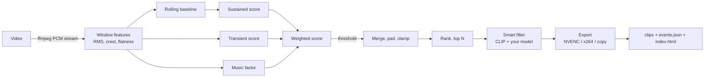

# game-clipper

[](https://github.com/sauravss98/Clip-It/actions/workflows/ci.yml)


**Automatically find the action in no-commentary gaming videos and export it as clips,
ready for YouTube Shorts.** Listens to the game audio, looks at the frames with a local
AI model, and learns your taste from 👍/👎 ratings. Everything runs offline on your PC.

Most "AI clippers" transcribe speech and ask an LLM what's interesting. That falls apart
on faceless gaming channels, where there's no voice at all. `game-clipper` listens to the
game itself: fights, kills, gunshots, explosions and crashes are louder and more
percussive than looting, walking or menus. It finds those moments, ranks them and cuts
them, even out of a three-hour recording, without loading the video into memory.

<!-- Replace with a real screenshot/GIF of the review page: docs/review-page.png -->


## Features

- **Audio-only detection** tuned per game with presets: `generic`, `fortnite`, `league`,
  `r6siege`, `gta5_online`, `gta6`.
- **Sustained + transient scoring**: catches long Fortnite build-fights *and* the single
  breach charge in a quiet R6 round.
- **Music/radio suppression** so GTA car radio and cutscenes don't flood you with false
  clips.
- **Smart filter (local AI, optional):** a CLIP vision model on your GPU looks at each
  candidate and drops lobbies, menus, loading and victory screens.
- **Your own model:** rate clips 👍/👎 and `game-clipper train` learns what *you* consider
  a good clip, evaluated honestly on held-out recordings against the audio-only ranking.
- **Fast export** with NVIDIA NVENC (auto-falls back to x264), or instant stream copy.
- **Shorts-ready vertical output**: 1080x1920 with a blurred background fill.
- **HDR to SDR** tone mapping for PS5 captures (best effort).
- **Review page** (`index.html`) to preview every clip in the browser, plus
  `events.json` with timestamps, scores and the reasons each moment was picked.
- **Local web UI**: drag in a video, pick a preset, watch the clips appear.
- Streams everything through ffmpeg: a 3-hour 1440p60 recording uses a few MB of RAM.

## Install

### 1. ffmpeg

| OS | Command |
|----|---------|
| **Windows** | `winget install Gyan.FFmpeg` (then open a new terminal) |
| macOS | `brew install ffmpeg` |
| Linux | `sudo apt install ffmpeg` (or your distro's equivalent) |

Check with `ffmpeg -version`.

### 2. game-clipper (Python 3.11+)

```powershell
git clone https://github.com/sauravss98/Clip-It.git
cd Clip-It
python -m venv .venv
.venv\Scripts\activate          # macOS/Linux: source .venv/bin/activate
pip install -e .                # add [plot] for PNG plots in `tune`
```

### 3. Optional: smart filter + trainable model (local AI)

```powershell
# NVIDIA GPU: install the CUDA build of PyTorch first (CPU also works, just slower)
pip install torch torchvision --index-url https://download.pytorch.org/whl/cu126
pip install -e ".[vision]"
```

The first run downloads the open CLIP model (~600 MB). After that everything is offline;
no frames or clips ever leave your computer.

## Quick start

### The easy way: web UI

```powershell
game-clipper ui
```

A browser tab opens. Drop in a recording (or paste its path, which skips the upload copy
for big files), pick your game, choose **Landscape** or **Shorts 9:16**, and hit
**Find clips**. Clips appear as they finish exporting.

Rate clips with 👍/👎 (on new clips or under **Your clips**). Once a game has 10+ rated
clips, press **Train my model**. Future runs for that game rank clips with your model.

### Command line

```powershell
# Find moments and print a table (writes events.json)
game-clipper detect "C:\Users\me\Videos\fortnite session.mp4" --preset fortnite

# Detect and export the 10 best as vertical Shorts
game-clipper clip "C:\Users\me\Videos\r6 ranked.mkv" --preset r6siege --top 10 --vertical

# Quick stream-copy cut (no re-encode, keyframe-accurate)
game-clipper clip match.mp4 --copy

# See why moments were (or weren't) picked, and save a plot
game-clipper tune "gta session.mp4" --preset gta5_online --plot gta.png

# Train your model from clips you rated in the UI
game-clipper train --preset fortnite
```

Output goes to `./output/<video name>/` (change with `--out`):

```
0001_00h03m12s_score81.mp4   # index, source timestamp, score
0002_00h17m45s_score88.mp4
events.json                  # every event: times, scores, reasons
index.html                   # open in a browser to review
```

### Common options

| Option | Meaning |
|--------|---------|
| `--preset NAME` | Game preset (see below). |
| `--top N` | Keep the N best moments (default 20). |
| `--threshold X` | Lower = more clips, higher = fewer. |
| `--pad-before S` / `--pad-after S` | Context around each moment (6 s / 4 s). |
| `--min-len S` / `--max-len S` | Clip length bounds (8 s / 60 s). |
| `--vertical` | 1080x1920 Shorts layout. |
| `--reencode` / `--copy` | Frame-accurate re-encode (default) vs fast stream copy. |
| `--audio-track N` | Which audio track to analyse (OBS multi-track recordings). |
| `--vision` / `--no-vision` | Smart filter on/off (default: on when the `[vision]` extra is installed). |
| `--config FILE` | Your own TOML presets (same format as [`presets.toml`](src/game_clipper/presets.toml)). |
| `--dry-run` | Show what would happen; write nothing. |

**`--reencode` vs `--copy`:** re-encoding cuts on the exact frame and is fast with NVENC.
`--copy` is near-instant and lossless, but a clip can only start on a keyframe, so it may
begin a few seconds early. `--vertical` always re-encodes.

## Presets

| Preset | Tuned for |
|--------|-----------|
| `generic` | Default. Balanced for most games, including story games (RDR2, Witcher 3, Ghost of Yotei; try `--max-len 90`). |
| `fortnite` | Sustained gunfights and build-fights. |
| `league` | Long teamfights over constant ability noise. |
| `r6siege` | Quiet tactical play broken by sharp gunfire and breaches (transient-heavy). |
| `gta5_online` | Gunfights and crashes, with strong music/radio suppression. |
| `gta6` | Like GTA 5 Online, for louder PS5 mixes (4K/HDR/VFR captures supported). |

## How detection works

1. **Loudness timeline.** ffmpeg decodes the audio to 16 kHz mono and streams it in
   chunks. For every half-second window we measure loudness (RMS in dB), crest factor
   (how spiky the waveform is) and spectral flatness (noise-like vs tonal).
2. **Adaptive baseline.** A rolling percentile over ~90 s gives "normal volume for this
   part of this recording", so a quiet mix and a loud mix are treated the same.
3. **Two scores per window:**
   - **Sustained**: how far above the baseline the audio sits. Great for long fights.
   - **Transient**: how sharply loudness jumps compared with the previous few seconds.
     Essential for games like R6 where one shot breaks a long silence.
4. **Music suppression.** Long stretches whose loudness barely changes look like music
   or radio, so they're penalised, unless something spikes well above them (a gunshot
   over the radio still counts). GTA presets also penalise tonal audio (music is tonal,
   gunfire is noise-like).
5. **Events.** Windows above the threshold are merged when close together, padded
   (6 s before, 4 s after) and clamped to 8 to 60 s. Long events are trimmed around their
   loudest moment.
6. **Ranking.** Each event is scored 0 to 100 from its peak, average intensity, sharpest
   onset and how long the action lasted. The top N are kept and exported in time order.

7. **Smart filter (optional).** Audio proposes 3x more candidates than you asked for.
   For each, six frames around the loudest moment are embedded with a local
   [OpenCLIP](https://github.com/mlfoundations/open_clip) model and compared with text
   descriptions ("a video game lobby", "a victory screen with a scoreboard", "intense
   combat"...). Candidates that are mostly menus are dropped; the rest are re-ranked.
8. **Your model (optional).** A regularised logistic regression (a *linear probe*) on
   the CLIP embedding plus the audio metrics, trained on your ratings. It's evaluated
   leave-one-video-out (clips from one recording look alike, so random splits would
   flatter it) and compared with the audio-only ranking before you rely on it. Final
   score = 40% audio + 60% your model.

Presets only change numbers (weights, thresholds, window sizes). There is no
game-specific code, so adding a game means adding a TOML section.



## Tuning tips per game

Start with `game-clipper tune VIDEO --preset X --plot out.png`. It prints a timeline,
the picked moments, anything dropped by `--top`, and **near misses** that just failed the
threshold, with the reason.

- **GTA 5 Online / GTA 6:** turn off the in-game radio and music when recording.
  Car radio is by far the biggest source of false clips. If you can't, keep
  `gta5_online`/`gta6`, which suppress steady music.
- **R6 Siege:** if footsteps or drones trigger clips, raise `--threshold` a little
  (0.6 to 0.7). If single shots are missed, lower it.
- **Fortnite:** storm and building noise can raise the baseline. Use `--max-len 45` for
  punchier Shorts.
- **League:** teamfights are long. The preset merges nearby fights (6 s gap). Use
  `--top 10` for a highlight reel.
- **OBS multi-track:** record game audio on its own track and point `--audio-track`
  at it, so Discord or music on another track never affect detection.
- **Too many clips?** Raise `--threshold`. **Too few?** Lower it, or check `tune`'s
  near misses.

## Development

```powershell
pip install -e ".[dev,plot]"
ruff check . ; ruff format --check .
pytest
```

Tests generate synthetic game-like audio and video with numpy and ffmpeg (no media files
in the repo): R6-style bursts in silence, bursts vs a long music section, and mixed
content. They also cover exports (duration, 1080x1920 vertical), the CLI and the web UI
API. CI runs on Ubuntu and Windows with Python 3.11 and 3.12. Without a GPU the export
falls back to x264 automatically.

```
src/game_clipper/
  cli.py            typer app: detect / clip / tune / train / ui
  pipeline.py       analyse -> export -> report, shared by CLI and UI
  config.py         preset + config loading and merging
  presets.toml      built-in presets
  ffmpeg.py         tool checks, probing, PCM streaming, encoder detection
  audio.py          per-window loudness / crest / flatness features
  detectors/        Detector protocol + LoudnessDetector
  events.py         merge, pad, clamp, score, rank (pure functions)
  export.py         cutting, NVENC fallback, vertical filter, HDR tone mapping
  report.py         events.json + index.html
  training.py       ratings -> dataset -> trained model
  vision/           frame sampling, CLIP embedder, zero-shot scenes, reranker, model
  web/              stdlib HTTP server + single-page UI (rating, library, training)
```

## Roadmap

- **League of Legends detector** using the official Live Client Data API (real
  `ChampionKill`, `Multikill` and `Ace` events), possibly with a live mode that saves the
  OBS Replay Buffer over OBS WebSocket.
- Kill-feed OCR (Fortnite "Eliminated", R6 kill feed) as extra model features.
- Learned audio embeddings (e.g. PANNs) instead of hand-made audio features.
- Auto-captions and text hooks burned into vertical clips.
- Packaged desktop app.

Detectors are pluggable (`detectors/base.py`), so these slot in without touching export
or the UI.

## License

[MIT](LICENSE)
